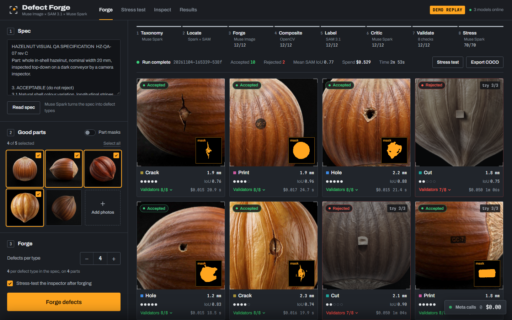
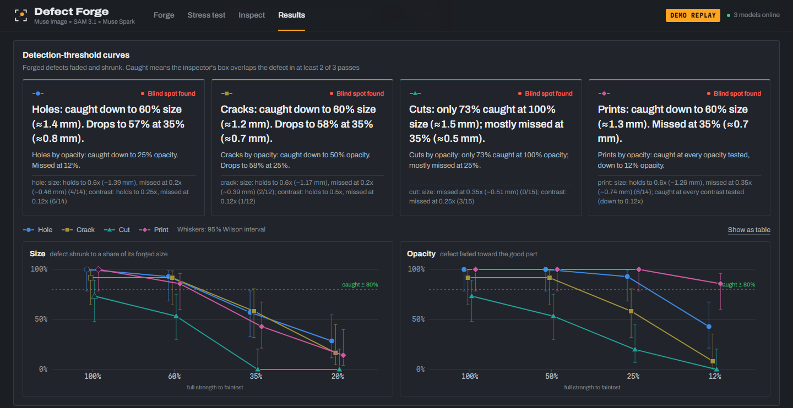

<div align="center">

# 🔨 Defect Forge

### Find the smallest defect your inspector still catches.

**No real defects needed · Labeled to the pixel · About $0.02 per defect**

[](https://defect-forge-kappa.vercel.app)




</div>

A new production line has no defect photos, so nobody knows what its visual inspection will miss until bad parts ship. Defect Forge reads your QA spec, paints realistic defects onto photos of good parts, and measures the smallest and faintest defect a Muse Spark inspector still catches. Use it to check an inspector before a line starts, to see which defect types it handles worst, or to export a labeled test set when you have no defect samples yet.

*Built for the Meta Global AI Developer Hackathon: Indie track, Push the Frontier.*

## 💡 Why you'll like it

| | |
|---|---|
| 🧪 **No defect samples needed** | A text spec and 3–5 photos of good parts are enough. |
| 📏 **Answers in millimetres** | You see the size and contrast where detection drops, for each defect type. |
| 🎯 **Labels you can trust** | Each forged defect's mask is known exactly, so the test is a measurement, not a model grading itself. |
| 🖼️ **Rest of the photo untouched** | Every pixel outside the defect stays byte-identical to the original. |
| 💵 **Cheap to run** | Each labeled defect costs about $0.02 and takes about 25 seconds. |
| 👀 **Every call visible** | A call log shows each model call with its latency and cost, and a budget limit stops spending. |
| 🧾 **Honest results** | The test plan was committed before each run, and null results and a withdrawn claim are published. |

## 🚀 Three steps



1. **Add your spec and photos.** Paste your QA spec and pick a few photos of good parts.
2. **Forge the defects.** Muse Image paints each defect type from the spec, and only samples that pass 8 checks are kept.
3. **Read the limit.** Run the stress test and see how small and faint each defect can get before the inspector misses it.

## 📥 Download

To look around first, open the [hosted demo](https://defect-forge-kappa.vercel.app). It replays a recorded live run from static files, so there is nothing to install and no key to add. It makes no Meta calls and shows a **DEMO REPLAY** badge.

To forge and inspect your own parts, run the app locally:

1. **Get the code.**

   ```bash
   git clone https://github.com/Hydra-Of-Malice/defect_forge.git
   cd defect_forge
   ```

2. **Run setup.** It creates a Python environment, builds the interface and copies `.env.example` to `.env`.

   ```bash
   # macOS / Linux
   ./scripts/setup.sh
   ```

   ```powershell
   # Windows
   powershell -ExecutionPolicy Bypass -File scripts\setup.ps1
   ```

3. **Add your key.** Put `MODEL_API_KEY=...` in `.env`, or leave it empty to run the demo replay.

4. **Start the app,** then open http://localhost:8765.

   ```bash
   # macOS / Linux
   ./scripts/dev.sh
   ```

   ```powershell
   # Windows
   powershell -ExecutionPolicy Bypass -File scripts\dev.ps1
   ```

| What you may see | What it means |
|---|---|
| PowerShell refuses to run a script | The scripts are unsigned. `-ExecutionPolicy Bypass` allows them for that one command. |
| An amber **DEMO REPLAY** badge | No key is set, or `DEMO_MODE=1`. You are watching a recorded run, and no Meta calls are made. |
| Spend on your Meta account | With a key, every forge, critic, mask and inspection is a live call. A run of 4 defect types × 3 samples plus the stress test costs about $0.60 and takes about 4 minutes. |
| A run that looks stuck | This is usually API latency. Muse Image edits have taken from 11 seconds to over 2 minutes. The call log shows each call. |

| Requirement | Details |
|---|---|
| Python | 3.12 or newer |
| Node.js | 20.19 or newer on the 20 line, or 22.12 or newer |
| Operating system | Windows, macOS or Linux. Only Windows has been run end to end. |
| GPU | Not needed. All three models run on Meta's servers. |
| Disk space | About 650 MB after setup, plus about 190 MB if you download MVTec AD for the evaluation. |
| Meta Model API key | Needed for live runs only. Not included. |
| Internet | Needed for setup and live runs. |
| Phone camera | Optional. Needs an HTTPS tunnel, because browsers only allow the camera on HTTPS. |
| Not supported | Forging or inspecting on the hosted demo. Logins or shared use. Stress-testing inspectors other than Muse Spark from the interface. Training models on forged images. |

To use a phone camera, run this and open the https URL on the phone. The Inspect page also accepts a photo upload, which opens the phone's native camera.

```bash
cloudflared tunnel --url http://localhost:8765
```

## 🔍 What it does

| Stage | What happens |
|---|---|
| Taxonomy | Muse Spark turns the spec into a list of defect types, each tied to its spec clause. |
| Locate | Muse Spark finds the part in each photo, SAM 3.1 masks it, and 512 px crops are sampled inside it. |
| Forge | Muse Image paints one defect onto each crop. |
| Composite | OpenCV aligns the edit, matches its colour and pastes back only the changed pixels. |
| Label | SAM 3.1 draws a tight mask that cross-checks the changed region. |
| Critic | Muse Spark judges realism and either accepts the sample or writes a revised prompt, up to 3 attempts. |
| Validate | 8 checks decide whether the sample is kept: for example, the defect lies on the part and nothing outside it changed. |
| Stress | Each accepted defect is shown at 4 opacities and 3 smaller sizes. The inspector checks every variant and the unedited parts. |
| Results | Detection-threshold curves per defect type, with Wilson 95% intervals. |
| Export | Accepted samples download as a COCO evaluation suite with masks and provenance. |
| Inspect | Check a real part from a camera or photo. Muse Spark judges it against the spec and SAM 3.1 outlines what it found. |

### 📊 What we measured


*Every defect above was forged by Muse Image onto a good hazelnut that Muse Image also made, then labeled to the pixel and accepted by all 8 checks.*

The protocol in [EVAL.md](EVAL.md) was committed before each run. An audit of our own first results then found problems, so we re-ran the evaluation with location checks, unedited controls and 3 passes. These are the corrected numbers. Full tables are in [docs/results/eval.md](docs/results/eval.md).

**Where the Muse Spark inspector stops.** Forged hazelnut defects, shrunk step by step, with the inspector seeing only the spec. A defect counts as caught when the inspector's box overlaps it in at least 2 of 3 passes.

| Defect | Full size | 60% | 35% | 20% | Box within 1 mm at 35% / 20%* |
|---|---|---|---|---|---|
| Hole | 14/14 | 13/14 (≈1.4 mm) | 8/14 (≈0.8 mm) | 4/14 (≈0.46 mm) | 14/14, 14/14 |
| Print (dark ink) | 14/14 | 12/14 (≈1.3 mm) | 6/14 (≈0.74 mm) | 2/14 (≈0.42 mm) | 13/14, 12/14 |
| Crack | 11/12 | 11/12 (≈1.2 mm) | 7/12 (≈0.68 mm) | 2/12 (≈0.39 mm) | 9/12, 3/12 |
| Cut | 11/15 | 8/15 (≈0.88 mm) | 0/15 (≈0.51 mm) | 0/15 (≈0.29 mm) | 0/15, 0/15 |

*Post-hoc check, not pre-registered.

There are two different limits here. Sub-millimetre holes and prints are *noticed* but not *pinpointed*: the box misses by a median of 0.2–0.5 mm. Cuts are the weakest type: 73% caught at full size and none at about 0.5 mm.

| Measurement | Result |
|---|---|
| Real benchmark (MVTec AD hazelnut test split, spec-only inspector, 3 passes) | **93.9–97.0% recall** on 66 defective images and **100% specificity** on 40 good ones |
| Real print defects | The weak spot, at 12–14 of 16, because white print is read as "specular gloss" |
| False alarms on unedited parts | 3 of 48 inspections (6%, 95% CI 2–17%) |
| Agreement between passes | All 3 passes agreed on 86% of the 385 variants |
| Mask quality | SAM 3.1 tight-box masks reach a median IoU of **0.84** against ground truth on 70 real defects. Forged masks agree with SAM at a mean IoU of 0.82. |
| Forge yield | 55 of 60 forgeries accepted (92%) after critic-driven retries |
| Cost | **$0.020 and 25 s per pixel-labeled defect**. The evaluation cost $4.85 and the revalidation $6.45 of Meta API spend. |

## ⚙️ How it works

```text
 QA spec ─────► defect types ─┐
                              ├─► forge ──► composite ──► critic + 8 checks
 good photos ──► part mask ───┘     ▲                       │      │
                                    └──── revised prompt ───┘      │ accepted
                                                                   ▼
 threshold curves ◄── inspector ◄── severity ladder ◄── labeled suite ──► COCO export
```

The compositor, severity ladder, validators and statistics never call a model. Muse Image edits come back resized, shifted 0–3 px and slightly colour-drifted, so we align them and keep only the changed region. The UI's call log shows each Meta call with model, latency and cost. `var/ledger.jsonl` records them all, and a budget guard stops spending at `BUDGET_USD`.

| Component | Purpose | License |
|---|---|---|
| `muse-spark-1.3` (Meta Model API, Meta-hosted) | Spec to taxonomy, finding the part, realism critic with revised prompts, and the inspector under test | Meta Model API Terms |
| `muse-image-1.0` (Meta Model API, Meta-hosted) | Forges each defect. Also made the sample good parts in `fixtures/parts/`. | Meta Model API Terms |
| `sam-3.1` (Meta Model API, Meta-hosted) | Part masks, tight-box masks that cross-check every forgery, and the mask behind every live inspection claim | Meta Model API Terms |
| `meta-sam-parser` | Builds SAM prompts and decodes its masks | SAM License (Meta) |
| `openai` Python package | OpenAI-compatible client, pointed at the Meta Model API | Apache-2.0 |
| FastAPI, Uvicorn | Backend, event stream and file serving | MIT or BSD |
| OpenCV, NumPy, Pillow | Alignment, compositing, severity ladder and validators | Apache-2.0, BSD-3-Clause, MIT-CMU |
| React, Vite, Tailwind CSS, TypeScript | The interface | MIT (TypeScript: Apache-2.0) |
| MVTec AD `hazelnut` | Local evaluation only, never committed | CC BY-NC-SA 4.0 |

**No other model runs at runtime**: no TTS, embeddings or local neural networks. OpenCV, NumPy and Pillow are classical code.

## 🛡️ Responsible use

- Forged defects look real. Use them for testing only, and never present them as photos of real parts, for example in a warranty claim, a supplier dispute or a product review.
- Forged images are for **evaluation, benchmarking and in-context inspection by Meta models**, consistent with the Meta Model API Terms (§10.1(ix) evaluation safe harbor). Defect Forge does not train models on Muse Image outputs, and the COCO export is labeled as an evaluation suite.
- A good result here does not certify an inspection line. Check real parts before you rely on any inspector, especially for anything that affects safety.
- **MVTec AD** (CC BY-NC-SA 4.0) is downloaded locally for evaluation only and never committed.
- A phone tunnel exposes your live app with no login. Set `BUDGET_USD` just above your current spend while it is open.

## ⚠️ Known limits

- Severity is synthetic: OpenCV fades and shrinks of a forged defect. Below the smallest real defect in MVTec (1.7 mm), the curves have no real-world check. The physical test in `eval/home_check.py` has not been run yet.
- Forged defects are much smaller than MVTec's, so real and forged barely overlap. Only holes have a usable shared range (1.7–2.9 mm), where they agree: real 5/5, forged 13/13.
- Forged defects are not a stand-in for every real defect. Bold forged white print was caught 12/12, while real white print was missed.
- We withdrew a claim. We first reported that two forged white-print examples fixed that blind spot, but that run also contained 2 good photos, so it was confounded. In the controlled re-run, forged examples alone earned no credit under a rule fixed in advance (real print pooled over 3 passes: spec only 43/51, good photos 47/51, forged 46/51, both 50/51). Both together scored best, but the difference from good photos alone is 2 images and not significant.
- Examples can hurt. With 8 generic forged examples in the prompt, the inspector flagged 59 of 141 faint variants, against 70–74 in three spec-only passes (exact McNemar p = 0.0015–0.035). The forged-examples side was run once, and the cause is untested.
- Results cover hazelnuts on a dark background only. Other parts need their own spec and photos.
- Sizes in mm assume the spec's 20 mm nominal hazelnut width.
- The critic and the inspector are both Muse Spark, but the headline curves don't depend on the critic.
- Inspector results vary between identical runs, and the API has no seed parameter. That is why key measurements use 3 passes.
- The evaluated forgeries used an earlier way of masking the part (point prompts). Current runs use a Muse Spark box into SAM 3.1.
- The stress test only drives the built-in Muse Spark inspector. To test another inspector, export the COCO suite and run it yourself.
- The hosted demo replays one small recorded run, so its Stress test page shows that run's numbers, not the evaluation above. Its Inspect page returns a recorded result, not one for your photo.
- The macOS and Linux scripts are included but have not been run end to end.
- The app is a single-user local tool. There are no logins, and state lives on disk as JSON.

## 🛠️ Development

Prerequisites: Git, Python 3.12+ and Node 20.19+. Follow the setup steps under [Download](#-download), then activate the virtual environment.

```bash
source .venv/bin/activate          # Windows: .venv\Scripts\Activate.ps1
python -m pytest -q tests          # offline: fake Meta transport, no key needed
python scripts/system_check.py     # every live path, PASS or FAIL; about $0.30
```

Frontend hot reload runs Vite on :5173, proxied to :8765. On Windows, use `scripts\dev.ps1 -Dev`.

```bash
./scripts/dev.sh --dev
```

Build the interface from `frontend/`:

```bash
npm run build                      # served by the backend at :8765
npm run build:static               # static replay for the hosted demo, in dist-static/
```

Reproduce the evaluation:

```bash
python eval/download_mvtec.py      # MVTec AD hazelnut (CC BY-NC-SA) into data/ (gitignored, about 190 MB)
python eval/run_eval.py            # pre-registered protocol in EVAL.md; resumable; about $5 from scratch
python eval/revalidate.py          # addendum: 3 located passes, controls, attribution; about $7
python eval/box_distance.py        # post-hoc box accuracy on small defects; no API calls
```

| Setting in `.env` | Default | Purpose |
|---|---|---|
| `MODEL_API_KEY` | empty | Meta Model API key. Empty means demo replay. |
| `MODEL_API_BASE_URL` | `https://api.meta.ai/v1` | API endpoint |
| `DEMO_MODE` | `0` | `1` replays the recorded run in `fixtures/demo_run/` and shows the badge |
| `BUDGET_USD` | `100` | Refuses new calls once `var/ledger.jsonl` passes this amount |

| Folder | Contents |
|---|---|
| `backend/app/` | FastAPI app: `meta/` (API client, cost ledger), `forge/` (spec, compositor, validators, severity ladder), `inspect/`, `export/`, `runs.py` (run engine), `main.py` (routes) |
| `frontend/` | Vite, React, TypeScript and Tailwind: Forge, Stress test, Inspect, Results and the call log |
| `eval/` | Evaluation scripts, including the physical check in `home_check.py` |
| `tests/` | pytest: compositor, severity, validators, COCO RLE, inspector, a full fake-transport run and the demo API |
| `scripts/` | Setup, dev server, phone tunnel, live system check and demo recording |
| `spikes/` | The gate tests that de-risked the build |
| `fixtures/` | Sample parts made with Muse Image and the recorded demo run (no MVTec images) |
| `docs/` | [Results](docs/results/eval.md), [API contract](docs/api-contract.md), [gate results](docs/gate-results.md), [friction log](docs/friction-log.md) |
| `reports/`, `research_notes/` | Background research from before the build |

## 📄 License

No license has been chosen yet, so all rights are reserved. Third-party software, data and related work are listed in [THIRD_PARTY.md](THIRD_PARTY.md).
