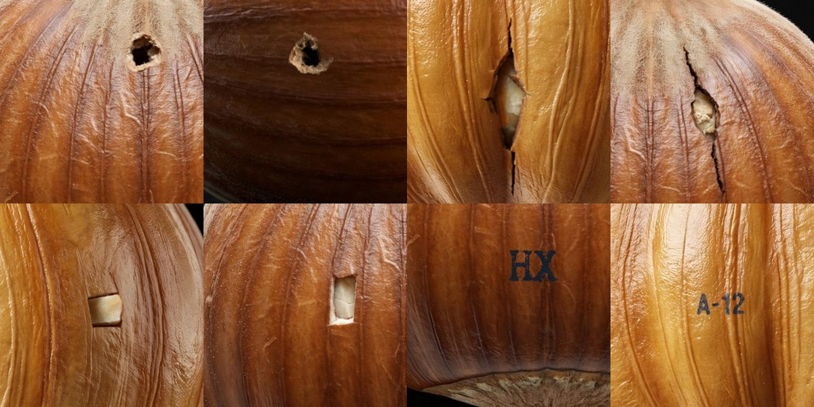

# Defect Forge

**Measure where your visual inspector stops seeing defects, before your line makes one.**

Defect Forge reads your QA spec, forges realistic defects onto photos of **good** parts with **Muse Image**, labels them to the pixel with **SAM 3.1**, and then stress-tests a **Muse Spark** inspector on a deterministic severity ladder. It reports the smallest and faintest defect the inspector still catches.

*Meta Global AI Developer Hackathon: Indie track, Push the Frontier.*

<!-- RESULTS:START -->


*Every defect above was forged by Muse Image onto a Muse-Image-generated good hazelnut, labeled to the pixel and accepted by 8 deterministic validators.*

## Results

The protocol in [EVAL.md](EVAL.md) was committed before each run. An audit of our own first results then found problems, so we re-ran the evaluation with location checks, unedited controls and 3 passes. This section reports the corrected numbers. Full tables are in [docs/results/eval.md](docs/results/eval.md).

**Where the Muse Spark inspector stops.** Forged hazelnut defects, shrunk step by step, with the inspector seeing only the spec. A defect counts as caught when the inspector's box overlaps it in at least 2 of 3 passes:

| Defect | Full size | 60% | 35% | 20% | Box within 1 mm at 35% / 20%* |
|---|---|---|---|---|---|
| Hole | 14/14 | 13/14 (≈1.4 mm) | 8/14 (≈0.8 mm) | 4/14 (≈0.46 mm) | 14/14, 14/14 |
| Print (dark ink) | 14/14 | 12/14 (≈1.3 mm) | 6/14 (≈0.74 mm) | 2/14 (≈0.42 mm) | 13/14, 12/14 |
| Crack | 11/12 | 11/12 (≈1.2 mm) | 7/12 (≈0.68 mm) | 2/12 (≈0.39 mm) | 9/12, 3/12 |
| Cut | 11/15 | 8/15 (≈0.88 mm) | 0/15 (≈0.51 mm) | 0/15 (≈0.29 mm) | 0/15, 0/15 |

*Post-hoc check, not pre-registered.

- **Two different limits.** Sub-millimetre holes and prints are *noticed* but not *pinpointed*: the box misses by a median of 0.2–0.5 mm. Cuts are the weakest type: 73% caught at full size and none at about 0.5 mm.
- **Controls:** 3 of 48 inspections of unedited parts were flagged (6%, 95% CI 2–17%). All 3 passes agreed on 87% of the 385 variants.
- **Real benchmark** (MVTec AD hazelnut test split, spec-only inspector, 3 passes): **93.9–97.0% recall** on 66 defective images and **100% specificity** on 40 good ones. Print is the weak spot, at 12–14 of 16, because white print is read as "specular gloss".
- **A claim we withdrew.** We first reported that two forged white-print examples fixed that blind spot. That run also contained 2 good photos, so it was confounded. In the controlled re-run, forged examples alone earned no credit under a rule fixed in advance (real print pooled over 3 passes: spec only 43/51, good photos 47/51, forged 46/51, both 50/51). Both together scored best, but the difference from good photos alone is 2 images and not significant. Forging also did not reproduce the blind spot: bold forged white print was caught 12/12.
- **Examples can hurt.** With 8 generic forged examples in the prompt, the inspector flagged 59 of 141 faint variants, against 70–74 in three spec-only passes (exact McNemar p = 0.0015–0.035). The forged-examples side was run once, and the cause is untested.
- **What this does not prove yet.** Forged defects are much smaller than MVTec's, so real and forged barely overlap. Only holes have a usable shared range (1.7–2.9 mm), where they agree: real 5/5, forged 13/13. Below 1.7 mm, the curves have no real-world check until the physical test in `eval/home_check.py` is run.
- **Labels:** SAM 3.1 tight-box masks reach a median IoU of **0.84** against ground truth on 70 real defects. Forged masks agree with SAM at a mean IoU of 0.82.
- **Cost:** 55/60 forgeries accepted (92%) after critic-driven retries, at **$0.020 and 25 s per pixel-labeled defect**. The evaluation cost $4.85 and the revalidation $6.45 of Meta API spend.
<!-- RESULTS:END -->

## Why

A new production line has no defect images. Inspection systems get validated on the few defects that happen to show up, and nobody knows the detection limit until bad parts ship. Synthetic-defect tools exist, but they need real defect samples or CAD models. Defect Forge needs **zero real defects**: a text spec and 3–5 photos of good parts are enough.

## How it works

```mermaid
flowchart LR
  A[QA spec text] -->|muse-spark-1.3<br/>strict JSON| B[Defect taxonomy<br/>clause, visual description]
  P[Good-part photos] -->|muse-spark-1.3 box<br/>into sam-3.1| M[Part mask]
  M --> C[Sample 512px crops<br/>inside the part]
  B --> E
  C --> E[muse-image-1.0<br/>/v1/images/edits]
  E --> K[Deterministic compositor<br/>ECC align, colour match, LAB diff,<br/>paste changed pixels only]
  K -->|sam-3.1 tight box| S[Mask cross-check IoU]
  K -->|muse-spark-1.3| R[Realism critic<br/>revised prompt, retry x3]
  S --> V[8 validators]
  R --> V
  V -->|accepted| D[(Pixel-labeled defect suite<br/>COCO export + provenance)]
  D --> L[Severity ladder<br/>OpenCV fade and shrink]
  L -->|muse-spark-1.3 inspector| T[Detection-threshold curves<br/>Wilson 95% CIs, mm]
```



- **Deterministic core.** The compositor, the severity ladder, the validators and the statistics never call a model. Muse Image edits come back resized, shifted 0–3 px and slightly colour-drifted. We align them, keep only the changed region, and every pixel outside the mask is byte-identical to the original (validator V1).
- **Ground truth by construction.** Each forged defect's mask and severity are known exactly, so the stress test is a measurement, not a model grading itself.
- **Agentic loop.** The Muse Spark critic either accepts a forgery or writes a revised prompt for Muse Image, with up to 3 attempts.
- **Every call is visible.** The UI's call-log drawer shows each Meta call with model, latency and cost. `var/ledger.jsonl` records them all, and a budget guard stops spending at `BUDGET_USD`.

### Meta models and where they run

| Model | Where it runs | What it does here |
|---|---|---|
| `muse-spark-1.3` | Meta Model API (Meta-hosted) | Spec → taxonomy (strict JSON); finding the part in a photo; realism critic with revised prompts; the inspector under test (strict JSON, 0–1000 boxes, prompt caching) |
| `muse-image-1.0` | Meta Model API (Meta-hosted) | Forges each defect (`/v1/images/edits`); generated the sample good parts in `fixtures/parts/` (`/v1/images/generations`) |
| `sam-3.1` | Meta Model API (Meta-hosted) | Part masks (from Spark's box); tight-box masks that cross-check every forgery; the mask behind every live inspection claim |

**No other model runs at runtime**: no TTS, embeddings or local neural networks. OpenCV, NumPy and Pillow are classical code. Coding assistants were used to write code.

## Quickstart

Requirements: Python 3.11+ and Node 20+.

```bash
# macOS / Linux
./scripts/setup.sh            # venv + backend deps, frontend build, .env from .env.example
# put MODEL_API_KEY=... in .env (or leave it empty for demo replay)
./scripts/dev.sh              # http://localhost:8765
```

```powershell
# Windows
powershell -ExecutionPolicy Bypass -File scripts\setup.ps1
powershell -ExecutionPolicy Bypass -File scripts\dev.ps1    # http://localhost:8765
```

- **Live mode (default when `MODEL_API_KEY` is set):** every forge, critic, mask and inspection is a live Meta Model API call. A run of 4 defect types × 3 samples plus the stress test costs about $0.60 and takes about 4 minutes.
- **Demo mode (`DEMO_MODE=1`, or no key):** replays a recorded live run from `fixtures/demo_run/` with its original event stream, and the UI shows an amber **DEMO REPLAY** badge. No Meta calls are made.
- **Phone camera:** browsers only allow the camera on HTTPS, so run `cloudflared tunnel --url http://localhost:8765` (or `scripts/tunnel.ps1`) and open the https URL on the phone. The Inspect page also accepts a photo upload, which opens the phone's native camera.
- **Frontend hot reload:** `./scripts/dev.sh --dev` (Vite on :5173, proxied to :8765).

### Reproduce the evaluation

```bash
python eval/download_mvtec.py      # MVTec AD hazelnut (CC BY-NC-SA) into data/ (gitignored, ~190 MB)
python eval/run_eval.py            # pre-registered protocol in EVAL.md; resumable; about $5 of API spend
python eval/revalidate.py          # addendum: 3 located passes, controls, attribution; about $7
python eval/box_distance.py        # post-hoc box accuracy on small defects; no API calls
python -m pytest -q tests          # offline: fake Meta transport, no key needed
```

## Repository map

```
backend/app/
  meta/        client.py (Spark JSON, Muse Image edits and generations, SAM 3.1, retries), ledger.py (cost, budget guard)
  forge/       spec.py (taxonomy, prompts, critic), locate.py, composite.py, validators.py, severity.py
  inspect/     inspector.py (Spark inspector + SAM mask sanitizer)
  export/      coco.py
  runs.py      run engine: parallel forging, SSE events, stress test, demo replay
  main.py      FastAPI routes (contract in docs/api-contract.md)
frontend/      Vite + React + TS + Tailwind: Forge, Stress test, Inspect, Results, call-log drawer
eval/          download_mvtec.py, run_eval.py
tests/         pytest: compositor, severity, validators, COCO RLE, inspector, full fake-transport run, demo API
spikes/        the gate tests that de-risked the build (docs/gate-results.md)
fixtures/      Muse-Image-generated sample parts and the recorded demo run (no MVTec images)
docs/          results/, gate-results.md, friction-log.md, api-contract.md, video-script.md
```

## Data, terms and limitations

- **MVTec AD** (CC BY-NC-SA 4.0) is downloaded locally for evaluation only and never committed.
- Forged images are used for **evaluation, benchmarking and in-context inspection by Meta models**, consistent with the Meta Model API Terms (§10.1(ix) evaluation safe harbor). Defect Forge does not train models on Muse Image outputs. The COCO export is labeled as an evaluation suite.
- **Limitations:**
  - Severity is synthetic: OpenCV fades and shrinks of a forged defect. Below the smallest real defect in MVTec (1.7 mm), the curves are unvalidated until the physical check with real drilled or marked parts is done.
  - Forged defects are not a stand-in for every real defect: bold forged white print was caught 12/12 while real white print was missed.
  - The critic and the inspector are both Muse Spark, but the headline curves don't depend on the critic.
  - Results are for hazelnuts on a dark background; other parts need their own spec and photos.

## Related work

- AnomalyAgent (arXiv 2604.07900): agentic anomaly synthesis.
- DualAnoDiff and AnomalyDiffusion: few-shot defect synthesis that needs real defects.
- MMAD (ICLR 2025): a VLM anomaly benchmark.
- Walkdown: a corrosion inspector in this hackathon that uses Muse Image for false-alarm stress images.
- CounterForge: controlled-change regression tests for VLMs.

Defect Forge differs in being spec-driven, needing zero real defects, and measuring detection thresholds.

More: [EVAL.md](EVAL.md) · [docs/results/eval.md](docs/results/eval.md) · [docs/gate-results.md](docs/gate-results.md) · [docs/friction-log.md](docs/friction-log.md) · [THIRD_PARTY.md](THIRD_PARTY.md) · [HANDOFF.md](HANDOFF.md)
